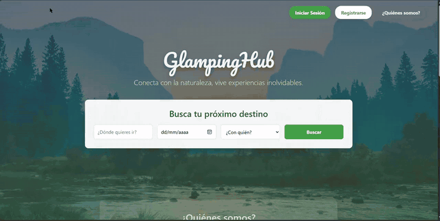

<div align="center">

# GlampingHub

**Plataforma web para encontrar y reservar glampings, cabañas, fincas y parques en Colombia.**




[Ver el video en mi portafolio](https://luism7p7.github.io/#glampinghub)

</div>

## ¿Qué hace?

- **Buscar destinos** por lugar, fecha y número de acompañantes.
- **Ver cada lugar** con foto, capacidad, ubicación y precio por noche.
- **Registrarse e iniciar sesión** para reservar.
- **Gestionar reservas:** crear, confirmar y cancelar, y consultar la disponibilidad de una finca.
- **Panel de administración** para gestionar fincas y reservas, con notificaciones para los clientes.

## Arquitectura

Aplicación **Spring Boot** con arquitectura por capas. El mismo servidor entrega el front-end (HTML, CSS y JavaScript en `static/`) y la API REST que este consume.

```
CampingHub/src/main/java/com/example/CampingHub
├── entities/       Finca, Reserva, Cliente, Usuario, Administrador, Notificacion (JPA)
├── repositories/   Spring Data JPA sobre MySQL
├── services/       Interfaces + Impl con la lógica de negocio
└── controllers/    API REST
```

| Recurso | Endpoints principales |
|---|---|
| `/fincas` | listar, ver, crear, actualizar, eliminar, `GET /disponibilidad/{id}` |
| `/reservas` | `POST /crear`, `PUT /confirmar/{id}`, `PUT /cancelar/{id}` |
| `/clientes` | registro, `PUT /realizar-reserva/{id}` |
| `/usuarios` | `POST /login`, `PUT /iniciar-sesion/{id}`, `PUT /cerrar-sesion/{id}` |
| `/administradores` | `PUT /gestionar-finca/{id}`, `PUT /gestionar-reserva/{id}` |
| `/notificaciones` | `PUT /enviar/{id}` |

## Cómo ejecutarlo

Requisitos: Java 21, Maven (o el `mvnw` incluido) y MySQL.

```bash
# 1. Crear la base de datos
mysql -u root -p -e "CREATE DATABASE campinghub_db;"

# 2. Definir la contraseña de MySQL como variable de entorno
#    Windows (PowerShell):  $env:DB_PASSWORD="tu_contraseña"
#    Linux / macOS:          export DB_PASSWORD="tu_contraseña"

# 3. Arrancar
cd CampingHub
./mvnw spring-boot:run
```

Abre **http://localhost:8080**. Hibernate crea las tablas automáticamente (`ddl-auto=update`).

## Documentación

El diagrama UML y el informe del sistema están en [glampinghub-uml](https://github.com/luism7p7/glampinghub-uml).

---

Proyecto individual de **Luis Miguel Muñoz Rendón** · [Portafolio](https://luism7p7.github.io) · [LinkedIn](https://www.linkedin.com/in/luismiguelmu%C3%B1ozrendon)
